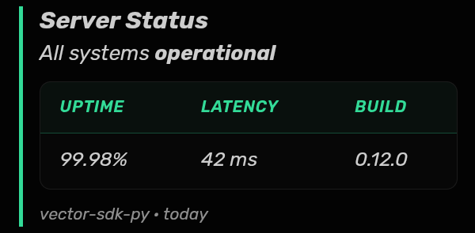

# vector-sdk (JavaScript / TypeScript)

**An unofficial, community-maintained, discord.js-style library for [Vector](https://vectorapp.io) messenger bots, powered by the official Rust [`vector_sdk`](https://crates.io/crates/vector_sdk).**

If you've written a discord.js bot, you already know this library: `Client`, `EmbedBuilder`, `ActionRowBuilder`, `SlashCommandBuilder`, collectors, permissions, managers. Underneath, every network, crypto and storage call runs in the Rust SDK (compiled into a native addon with [napi-rs](https://napi.rs)), so you get its MLS-style Communities, NIP-17 DMs, Mini Apps and voice without writing any Rust. It ships TypeScript sources compiled to JS with `.d.ts` files, so it works from both languages.

```js
const { Client, Events } = require("vector-sdk");

const client = new Client({ intents: [] });

client.once(Events.ClientReady, (c) => console.log(`Logged in as ${c.user.tag}`));
client.on(Events.MessageCreate, async (msg) => {
  if (msg.content === "!ping") await msg.reply("pong 🏓");
});

client.login(process.env.VECTOR_NSEC); // an nsec1… key, not a Discord token
```

It also runs **BDScript 2** (Bot Designer for Discord) and **D.js-BDscript** bots, has an **aoi.js-style** `AoiClient`, a Discord-compatible **webhook server**, and a **porting kit** that runs an existing discord.js bot unchanged.



---

## Contents

[Install](#install) · [Your bot's key](#your-bots-key) · [Coming from discord.js](#coming-from-discordjs) · [Porting an existing bot](#porting-an-existing-discordjs-bot) · [Slash commands](#slash-commands) · [Embeds](#embeds) · [Buttons, selects, modals](#buttons-selects-modals) · [Custom emoji](#custom-emoji) · [Voice](#voice) · [Mini Apps](#mini-apps-webxdc) · [BDScript](#bdscript-bot-designer-for-discord) · [aoi.js-style interface](#aoijs-style-interface) · [Webhooks](#discord-compatible-webhooks) · [Reply ordering](#reply-ordering) · [Known issues](#known-issues-and-workarounds) · [Development](#development)

---

## Install

Requires **Node ≥ 22.5** (webhooks and BDScript storage use the built-in `node:sqlite`).

```sh
git clone https://github.com/lucky-edgelord/vector-sdk-js
cd vector-sdk-js
npm install
npm run build:native   # compiles the Rust addon (needs a Rust toolchain and cmake)
npm run build          # compiles the TypeScript to dist/
```

The native build needs [rustup](https://rustup.rs) and `cmake` (for the Opus voice codec). The first build takes a few
minutes; later builds reuse the cache. It produces `native/vector_sdk_js.<platform>-<arch>.node`, which is gitignored, so
build it on every OS you deploy to. Prebuilt addons and an npm release are not published yet.

Voice and Mini Apps are built by default. Speech-to-text (whisper.cpp), Tor and I2P are opt-in Cargo features
(`cd native && cargo build --release --features whisper,tor`). `Client.sdkVersion` and the native `features()` tell
you what your build has.

### Your bot's key

A Vector identity is a Nostr key. `client.login(nsec)` logs in with an `nsec1…` key, which plays the role of
discord.js's token. `$VECTOR_NSEC` is used when you pass nothing.

```js
console.log(Client.generateNsec()); // mint one and keep it secret
```

Set `dataDir` (`new Client({ dataDir: "./vector-data" })`) to choose where the bot keeps its database and keys. A Discord token passed to `login()` is
rejected with a message that says what to use instead.

---

## Coming from discord.js

| discord.js | Vector |
| --- | --- |
| Guild | Community (`guild.id` is the community id) |
| User / member id | npub (`user.toString()` → `nostr:npub…`) |
| Embeds | faux embeds: quote bar, fields table, image and footer as separate messages |
| Buttons / select menus | reactions on the message (emoji, 🇦🇧… or 1️⃣2️⃣…), arriving as `ButtonInteraction` / `StringSelectMenuInteraction` |
| Slash commands | Vector native commands (subcommands become `cmd-sub`) |
| Modals | questions asked in chat; `awaitModalSubmit` works |
| Ephemeral replies | sent by DM |
| Webhooks | `channel.createWebhook()` plus a Discord-compatible HTTP server |
| Voice | `channel.join()` / `joinVoiceChannel()`; bots can also *listen* |
| Custom emoji | equipped emoji packs: `client.emojis`, `:name:` and `<:name:id>` |
| Permissions | Vector's 30 community permissions; Discord-only flags are always granted |

Events that work: `ready` / `clientReady`, `messageCreate`, `messageUpdate`, `messageDelete`, `messageReactionAdd`,
`messageReactionRemove`, `guildCreate`, `guildDelete`, `guildUpdate`, `guildMemberAdd`, `guildMemberRemove`,
`typingStart`, `interactionCreate`, plus Vector extras (`guildInvite`, `miniAppSession`, `voiceStateUpdate`).

Managers and structures: `guild.channels`, `roles`, `members`, `bans`, `invites`; `channel.messages`,
`permissionOverwrites`; `message.reply/edit/delete/react/pin`; collectors and `awaitMessages` / `awaitReactions`;
`AttachmentBuilder`; `PermissionsBitField`; `Collection`.

Intents and partials are accepted and ignored. Threads, stickers, scheduled events, AutoMod, polls and sharding don't
exist on Vector; their names are importable but throw `NotSupportedOnVector` when used.

## Porting an existing discord.js bot

See the full [porting guide](docs/porting-from-discordjs.md). `vector-port check <dir>` reports what needs attention.

No edits needed: run it through the compat runner and `require("discord.js")` resolves to this library.

```sh
npx vector-port check ./my-bot           # Discord ids, INTEGER id columns, Discord-only APIs
VECTOR_NSEC=nsec1… npx vector-run ./my-bot/index.js     # same as: node -r vector-sdk/register index.js
```

`vector-run` also aliases `@discordjs/builders`, `@discordjs/rest`, `@discordjs/voice`, `discord-api-types` and
`aoi.js`. A `deploy-commands.js` that calls `rest.put(Routes.applicationCommands(…))` saves the commands to
`.vector-commands.json`, and the bot registers them at its next login. Differences that remain are about Vector, not
the API: IDs are strings (use TEXT columns, not INTEGER) and there's no presence.

## Slash commands

```js
const { SlashCommandBuilder } = require("vector-sdk");

await client.application.commands.set([
  new SlashCommandBuilder().setName("echo").setDescription("Repeat text")
    .addStringOption((o) => o.setName("text").setDescription("what to say").setRequired(true)),
]);

client.on("interactionCreate", async (i) => {
  if (i.isChatInputCommand() && i.commandName === "echo") await i.reply(i.options.getString("text", true));
});
```

Commands are published to the bot's manifest, so they appear in Vector's `/` picker with typed arguments (text, int,
number, flag, user, choice). Registration is bot-wide: guild ids are ignored. Commands whose name or options Vector
can't express stay unregistered, and a `warn` event says so.

## Embeds

```js
const { EmbedBuilder } = require("vector-sdk");

await channel.send({
  embeds: [new EmbedBuilder().setTitle("Deploy succeeded").setDescription("Release **v1.4.2** is live.")
    .addFields({ name: "Env", value: "prod", inline: true }, { name: "Time", value: "42s", inline: true })
    .setFooter({ text: "CI pipeline" })],
});
```

Vector has no embed object, so an embed renders as a quote-bar message in Vector's mint colour: title and body, a
fields table, then the image and footer as separate messages. Colours you set are ignored. Image URLs are downloaded
and attached.

## Buttons, selects, modals

```js
const { ActionRowBuilder, ButtonBuilder, ButtonStyle } = require("vector-sdk");

const row = new ActionRowBuilder().addComponents(
  new ButtonBuilder().setCustomId("yes").setLabel("Yes").setEmoji("✅").setStyle(ButtonStyle.Success),
  new ButtonBuilder().setCustomId("no").setLabel("No").setEmoji("❌").setStyle(ButtonStyle.Danger),
);
await channel.send({ content: "Ship it?", components: [row] });
client.on("interactionCreate", (i) => i.isButton() && i.reply(`${i.user.username} pressed ${i.customId}`));
```

Components become reactions the bot adds under the message; a tap is delivered as a normal interaction. A button
without an emoji gets 🇦 🇧 🇨 with a legend, and select options get 1️⃣ 2️⃣ 3️⃣. Ordinary reactions on other
messages are plain `messageReactionAdd` events.

## Custom emoji

```js
await client.emojis.subscribe("naddr1…");   // equip an emoji pack once
await message.react(":wave:");               // or "<:wave:123>", or client.emojis.resolve("wave")
await channel.send("hello :wave:");
```

## Voice

```js
const { createAudioResource } = require("vector-sdk");

const connection = await voiceChannel.join();
await connection.playAndWait(createAudioResource("song.mp3"));   // needs ffmpeg on PATH; PCM Buffers work too
for await (const speech of connection.listen()) {                // bots can hear: per-speaker 48 kHz PCM
  console.log(speech.userId, speech.pcm.length);
}
await connection.disconnect();
```

## Mini Apps (WebXDC)

```js
client.miniApps.register("vector-counter");           // or "*" for any app
client.on("miniAppSession", (session) => {
  session.on("data", (ev) => session.send({ echo: ev.json(), from: ev.verified_sender }));
});
await channel.sendMiniApp("app.xdc");                  // share an app
```

---

## BDScript (Bot Designer for Discord)

Run **BDScript 2** and **D.js-BDscript** bots on Vector: every BDFD function, every D.js-BDscript function, and a set
of Vector-only functions (`$npub`, `$expireIn`, `$sendMiniApp`, `$say`, …). A test keeps the function list complete.

```sh
VECTOR_NSEC=nsec1… npx vector-bdscript run examples/bdscript     # files reload when they change
npx vector-bdscript check ./my-bot                               # syntax-check every command
npx vector-bdscript functions                                    # list functions and their status
```

A bot is a folder with one command per file plus an optional `bot.json`:

```
---
trigger: !daily
---
$nomention
$cooldown[24h;Come back in %time%.]
$setUserVar[money;$sum[$getUserVar[money];100]]
+100 coins! You now have $getUserVar[money].
```

From JavaScript, either run a whole bot or attach the engine to a client you already have and call it directly:

```js
const { BDBot, BDScript, BDScriptError } = require("vector-sdk/bdscript");

const bot = new BDBot({ prefix: "!" });                       // its own Client, SQLite storage
bot.variables({ money: 0 });
bot.command({ trigger: "!balance", code: "$username has $getUserVar[money] coins." });
bot.login(process.env.VECTOR_NSEC);

const bd = new BDScript(client);                              // …or attach to an existing Client
const result = await bd.run("Hi $username!", message);        // result.text, result.embeds, result.ok
await bd.evaluate("$sum[2;3]");                               // "5", no bot needed
bd.function("shout", (ctx, text = "") => text.toUpperCase() + "!");   // new functions in JS: $shout[hi]
```

Callbacks (`$onJoined`, `$onInteraction`, `$awaitedCommand`, …), slash commands, buttons and menus (as reactions),
`$try/$catch`, `$async`, `$http`, `$json…` and BDFD's error messages all work. `$exec`, local files and HTTP are
switchable. The BDScript language is the engine's own; it is not an official BDFD implementation.

Guide: [docs/bdscript.md](docs/bdscript.md) · Functions: [docs/bdscript-functions.md](docs/bdscript-functions.md) · Example: [examples/bdscript](examples/bdscript)

## aoi.js-style interface

Prefer aoi.js's API? `AoiClient` gives you `client.command({...})`, `readyCommand`, `joinCommand`, `variables`,
`loadCommands`, `functionErrorCommand`, `loopCommand`, `awaitedCommand`, `interactionCommand` and `addFunction`. The
`code` strings are BDScript, and storage is SQLite.

```js
const { AoiClient } = require("vector-sdk/aoijs");

const client = new AoiClient({ prefix: "!", database: { path: "./database/aoi.db" } });
client.variables({ coins: 0 });
client.command({ name: "ping", code: "Pong! $ping ms" });
client.command({ name: "coins", code: "$username has $getUserVar[coins] coins." });
client.login(process.env.VECTOR_NSEC);
```

Under `vector-run`, `require("aoi.js")` resolves here too. This is the *interface*, not a port of aoi.js's own function
set: the code is BDScript, so embed functions don't take an index first (`$title[text]`, not `$title[1;text]`).

Guide: [docs/aoijs.md](docs/aoijs.md) · Example: [examples/aoijs](examples/aoijs)

## Discord-compatible webhooks

Run one small server and any tool that can post to a Discord webhook (GitHub, Grafana, CI, uptime monitors, your own
scripts) can post to a Vector channel instead. You swap the URL; nothing else changes.

```sh
VECTOR_NSEC=nsec1… npx vector-webhooks serve --port 8080 --base-url https://hooks.example.com
```

Admins type `!webhook create CI` in a channel and get the URL by DM: `https://hooks.example.com/api/webhooks/<id>/<token>`.
Supported: Discord execute (JSON or multipart with files, `?wait=true`), edit and delete of the messages a webhook
sent, `…/slack` and `…/github` bodies, `/api/v8`–`v10` prefixes, `429` with `Retry-After`, and an admin API.
Tokens are stored hashed in SQLite. In your bot, `channel.createWebhook()`, `Webhook#send` and `WebhookClient` work
like discord.js's.

Guide: [docs/webhooks.md](docs/webhooks.md)

## Reply ordering

Vector sorts messages by whole-second timestamps, so an instant reply could appear above the message it answers.
Sends therefore wait (at most ~2.5 s, usually well under one) until the bot's clock passes the incoming message's
second. `new Client({ replyOrdering: false })` turns it off.

## Known issues and workarounds

- **IDs are strings** (64-hex ids and npubs). Ported bots that store them in INTEGER database columns need TEXT
  columns; `vector-port check --fix` rewrites them.
- **Discord-only features are stubs.** Threads, stages, stickers, polls and sharding import fine and throw
  `NotSupportedOnVector` when used.
- **Reactions drive components.** A button or select is a set of reactions, so the bot needs permission to react, and a
  message with many components adds several reactions.
- **No presence.** `setPresence` is a no-op; `setActivity` sets the bot's profile status.
- **Slash commands are bot-wide**, can't be unregistered at runtime, and subcommands become `cmd-sub`.
- **One `dataDir` per bot.** Run several identities in one process by giving each `Client` its own `dataDir`.
- **Native addon per platform.** Build it on the OS you deploy to.

## Development

```sh
npm install
npm run build:native   # Rust addon
npm test               # type-checks, then runs the offline tests against a fake native bot
```

Layout: `native/` is the napi-rs binding (one `NativeBot.call(method, args, bytes)` dispatcher over `vector_sdk`),
and `src/` is the discord.js-style API built on top. Tests swap in a fake native module with `setNativeModule()`.

## License and affiliation

MIT (see [LICENSE](LICENSE)). The compiled Rust crate [`vector_sdk`](https://crates.io/crates/vector_sdk) is
MIT-licensed by the Vector team; its notice and other third-party notices are in
[THIRD_PARTY_NOTICES.md](THIRD_PARTY_NOTICES.md).

vector-sdk is an independent project. It is **not** affiliated with, endorsed by or maintained by Vector,
discord.js, Discord, Bot Designer for Discord (BDFD) or aoi.js. Those names are used only to say what the library is
compatible with (the API shapes and the `$function[arg;arg]` syntax); the code here is an independent implementation
that talks to Vector, not to Discord or BDFD.
